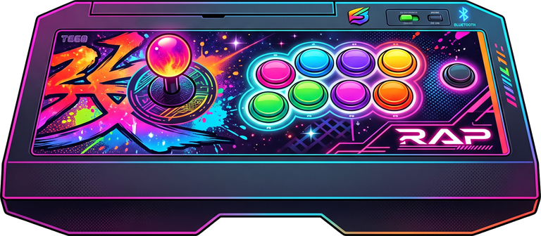
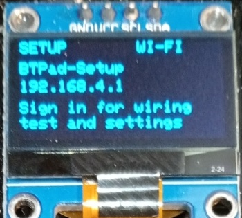
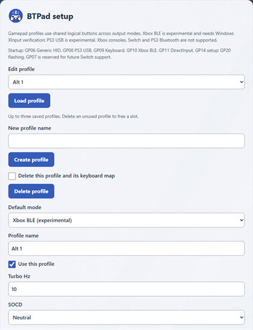
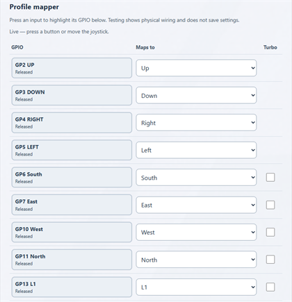
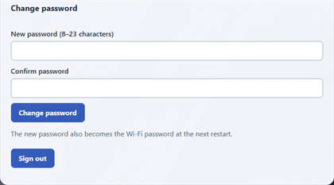
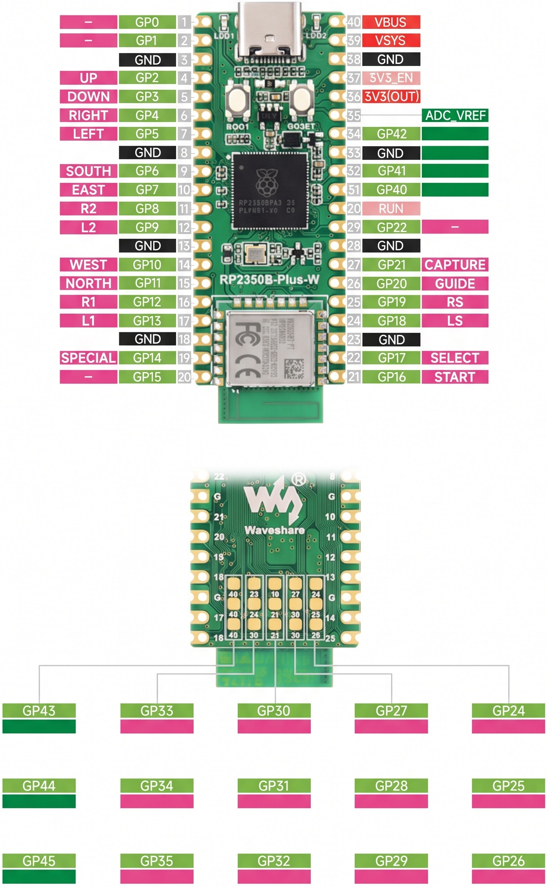

# BT-GP2350B-Plus-W-CE Bluetooth Controller Firmware

<p align="center">
  
</p>

Bluetooth controller firmware for the **Waveshare RP2350B-Plus-W**, built with Arduino-Pico. It supports wired buttons and a digital joystick, Bluetooth gamepad/keyboard output, a Wi-Fi configuration page with a live wiring tester, and an optional SSD1306 OLED.

**Status: development prototype, updated 2026-09-22.** The latest OLED firmware is flashed. Xbox BLE was user-confirmed working. The new Xbox Classic Bluetooth mode also pairs with a healthy Windows XInput driver; native XInput detects button activity and independent trigger presses in slot 0. MiSTer, XP, repeated power-cycle reconnect and native Guide behavior still need separate checks. PS3 USB is an experimental console-test mode; PS3 Bluetooth and Switch are not implemented.

## Current support

| Feature | State |
| --- | --- |
| DirectInput | User confirmed earlier operation; face-button numbering now follows btpad.md (West 1, South 2, East 3). |
| Generic HID | Eight-direction POV hat and independent Z/Rz triggers without duplicate trigger buttons. Desktop tests pass; latest Windows/MiSTer checks pending. |
| Xbox BLE | User confirmed working/stable on the latest build; Windows driver healthy and XInput API enumeration observed. MiSTer/reconnect/Guide acceptance pending. |
| Xbox Classic Bluetooth | Experimental, GP12 startup. Windows Classic XInput driver healthy; buttons and separate trigger presses observed through native XInput. XP/MiSTer/reconnect/Guide checks pending. |
| PS3 USB | Experimental DS3 reports and feature responses implemented; console test pending. Bluetooth PS3 not implemented. |
| Keyboard | Separate full keyboard map per profile, including modifiers, navigation, keypad and F1–F24; hardware validation pending. |
| Bluetooth sync | Hold GP20 for 3 seconds to toggle pairing/discovery. Basic pairing has been confirmed. |
| Automatic reconnect | Pairing closes on connection; saved-host retries and stalled-link recovery implemented. Power-cycle reconnect needs hardware verification. |
| Web setup | Password/default-mode changes smoke-tested; live GPIO wiring tester confirmed working by the user. |
| Profiles and input processing | Three shared profiles, remapping, turbo and SOCD implemented with desktop tests. Broader persistence/input hardware checks pending. |
| Optional OLED | No-OLED and OLED firmware builds pass; OLED hardware validation pending. |

Generic HID and DirectInput use **Bluetooth Classic HID**. **Xbox BLE (experimental)** is a separate BLE HID transport intended for Windows XInput, with independent triggers, a D-pad hat and Guide. Windows driver recognition and XInput API enumeration are verified on the latest build; Game Bar/Steam Guide behavior still needs testing. It does not provide Xbox-console support. PS3 USB is available experimentally; PS3 Bluetooth and Switch remain unavailable; PS4 is outside scope.

Gamepad profiles use the neutral names from `btpad.md`: South/East/West/North, L1/R1/L2/R2, Select/Start, LS/RS, Guide/Capture. They are shared across output protocols; changing the protocol does not replace the profile. This is the foundation for using one game profile across Xbox-style and future Switch output, although Switch support is not implemented yet. The separate **Keyboard mapper** stores physical GPIO-to-key mappings for each of the same three profiles without changing gamepad mappings. It supports six simultaneous ordinary keys plus all eight modifiers; characters follow the host keyboard layout.

The inputs are digital switches, so trigger axes have only released and fully pressed values. A trigger axis resting at its minimum is expected, including when its switch is disconnected. DirectInput retains its earlier axis/button trigger output; the duplicate-button correction applies to Generic HID.

## Profiles and shortcuts

The OLED shows the profile name (for example `Alt 1`) on the left and `Player: ?` below the connection status on the right. `?` means the host's player number is unavailable, not Player 1. Current Xbox BLE, Generic HID, DirectInput and keyboard protocols do not report player assignment to the firmware. PS3 USB can show 1–7 from host player LED commands; a game's own order can differ. Older OLED labels `P1` / `P2` / `P3` meant mapping profiles, never player slots. Long profile names are shortened to 12 characters on the OLED only.

The portal can create and delete profiles within three saved slots. Delete an unused slot before adding a new one when all three are full. Deleting the active profile selects another; the last remaining profile cannot be deleted. Each profile owns a separate keyboard map. Existing saved profiles are preserved.

| Hold with joystick | Action |
| --- | --- |
| Capture (GP21) + Left / Right | Previous / next existing profile |
| Capture (GP21) + Up / Down | Next / previous SOCD mode |
| Special (GP14) + Up / Down | Increase / decrease turbo speed, 2–30 Hz |
| Special (GP14) + game button | Toggle that button's turbo |
| Special (GP14) + Home / Guide (GP20) | Reconnect with the existing pairing; ask the host to reassess the player slot |

Each modifier hold performs one action; release before the next shortcut. Capture alone sends on release, so shortcuts do not also send Capture to the game. Shortcut inputs remain suppressed until released.

Player slots are assigned by the console/computer; the firmware does not force Player 2. Special + Home briefly disconnects and reconnects (USB in PS3 mode), preserving the controller identity and Bluetooth bonds. It does not send Home or enter pairing mode. Release both buttons before repeating. The host may assign the same slot again: this is not guaranteed Player 1 or P1–P4 cycling. Classic Bluetooth reconnect may take about 10 seconds; BLE reconnect timing depends on the host. Windows XInput assigns its indices automatically and does not permit changing them through XInput ([Microsoft documentation](https://learn.microsoft.com/en-us/windows/win32/xinput/getting-started-with-xinput)); games and MiSTer may use their own player order.

Startup buttons, held while plugging in: **GP06 Generic HID, GP08 PS3 USB, GP09 Keyboard, GP10 Xbox BLE, GP11 DirectInput, GP12 Xbox Classic Bluetooth, GP14 setup, GP20 flashing**. GP07 is reserved for future Switch support and currently leaves the saved default in use. With no button held, the saved default applies.

**Experimental Xbox Classic Bluetooth:** hold **GP12 (R1)** while plugging in, then release it. The OLED shows **XB-BT**. Hold GP20 for three seconds and pair **BTPad-Xbox-Classic**. This uses the Classic Xbox HID family associated with legacy 8BitDo XInput mode; it is a separate mode from Xbox BLE, with the same shared gamepad profiles. It can also be saved as the default in the web portal. Host compatibility, including XP and MiSTer, is not established by a successful firmware build. Capture has no native report in this older protocol but its profile/SOCD shortcuts still work; player assignment remains unknown on the OLED.

## Getting started

1. Wire inputs between their GPIO and GND; internal pull-ups are enabled. See the [GPIO map and controls](btpad_pico/README.md).
2. Hold **GP14 at power-on** to enter setup. Alternatively, with USB connected in a Bluetooth or keyboard mode, run `./tools/enter-web-setup.ps1 -Port COM10` (replace `COM10` with the board's port), or send `web` followed by a newline at 115200 baud. This restarts into setup once without changing your saved default. Connect to **BTPad-Setup** and open **http://192.168.4.1/**. Unplug and reconnect to return to the saved default.
3. On a fresh configuration, the Wi-Fi and admin password is **`changeme`**. Replace it when prompted. An existing saved password remains in use; Wi-Fi adopts a changed password on the next restart.
4. In **Profile mapper**, GPIO labels light up while inputs are held. Choose the default mode and restart with no buttons held.
5. Hold **GP20 for 3 seconds** to enable Bluetooth sync and pair from the host. Pairing closes automatically once connected; bonded hosts can then reconnect without a sync hold.

Boot overrides: **GP06 = Generic HID**, **GP09 = Keyboard**, **GP14 = setup**. GP08 selects experimental PS3 USB, GP10 Xbox BLE, GP11 DirectInput, and GP12 Xbox Classic Bluetooth. GP07 is reserved for unimplemented Switch support. Wi-Fi setup and Bluetooth play run in separate boot modes.

**Hold GP20 at power-on to enter USB firmware flashing mode.** This takes priority over all boot overrides. In normal play, GP20 short taps send Guide and a three-second hold toggles sync; GP21 is Capture, sent on release unless used in a shortcut. The new boot shortcut becomes available only after installing this update.

With the display fitted, use the **`-WithDisplay`** build. Its GP2040-CE-inspired screen shows mode, Bluetooth status, profile, live D-pad/buttons, turbo rings/rate and SOCD; setup mode shows the Wi-Fi name and URL. The expected display remains a 128×64 SSD1306 at `0x3C` on GP00/GP01. Hardware display and GP20 boot/sync checks remain pending.

After the latest update, test Generic HID's POV directions and trigger isolation, then pair once and power-cycle without sync to test reconnect. Redefine the controller inputs on MiSTer after changing direction-report behavior.

## OLED display

Normal controller mode shows the active protocol, profile name, Bluetooth status, player indicator, live inputs, turbo speed and SOCD mode. `Player: ?` means the host has not provided a player number.


Setup mode shows the **BTPad-Setup** Wi-Fi network and the web portal address, **http://192.168.4.1/**.



## BTPad-Setup screenshots

Manage profiles, choose the default controller mode, and configure turbo and SOCD.



Map GPIO inputs to shared controller buttons and check wiring with live input highlighting.



Change the setup password and sign out.



## Build and test

Requires Arduino CLI (tested with 1.2.0). The build script installs pinned dependencies into the ignored `.build/` directory:

```powershell
./build.ps1 -Install                 # Install dependencies and build without OLED
./build.ps1                          # Subsequent no-OLED build
./build.ps1 -Install -WithDisplay     # Install OLED dependencies and build with OLED
./build.ps1 -WithDisplay             # Subsequent OLED build
./tests/run.ps1                      # Eleven C++ suites; Visual Studio C++ tools required
node tests/wiring_test.cjs           # Wiring-page script tests; Node.js required
```

Pinned target: Arduino-Pico **6.1.0**, `waveshare_rp2350b_plus_w`, ARM at 150 MHz, 16 MB flash, IPv4 + Bluetooth. Optional display: SSD1306 128×64 at `0x3C`, SDA GP00 / SCL GP01. See the [firmware guide](btpad_pico/README.md) for the full board identifier and dependency versions.

Outputs are `.build/headless/btpad_pico.ino.uf2` and `.build/display/btpad_pico.ino.uf2`. Enter BOOTSEL and copy the appropriate UF2 to the RP2350 boot drive. The build script does not flash automatically.

All eleven C++ suites and the wiring-script tests pass. Both firmware variants build, and the OLED image is flashed with steady live connection diagnostics. The expanded keyboard mapper was browser-checked at 320px without horizontal overflow. See [VALIDATION.md](VALIDATION.md) for build hashes and remaining hardware checks.

## Known limitations and next work

- Verify the latest Generic HID behavior on Windows/MiSTer and automatic reconnect across power cycles and host availability changes.
- The pinned core stores Bluetooth bonds inside the firmware flash area; reflashing can require pairing again. Saved configuration/password storage is separate and is not necessarily erased by a UF2 update.
- Profiles are shared across modes. Versioned storage, power-loss recovery, profile import/export remain planned.
- The setup portal uses HTTP and stores its password in plaintext flash. It provides timed sessions and request verification; a dedicated physical password-recovery workflow remains planned.
- Xbox BLE Guide, trigger and reconnect checks remain; PS3 USB needs console acceptance. PS3 Bluetooth and Switch require separate implementations.

## Pinout

<p align="center">
  
</p>

## Project contents

- [Firmware and detailed usage](btpad_pico/README.md)
- [Development plan](DEVELOPMENT_PLAN.md) and [task list](TASKS.md)
- [Protocol status and research](PROTOCOLS.md)
- [Validation record](VALIDATION.md)
- [Original requirements](btpad.md), including future targets rather than only implemented features

Source, documentation, tests and build scripts are versioned. Downloaded toolchains, build logs, test executables and generated firmware are excluded from Git.
